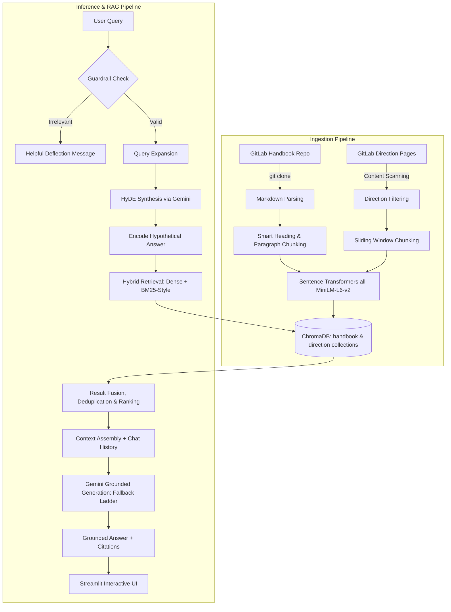

# 🤖 GitLab Handbook GenAI Assistant

An enterprise-grade, conversational GenAI assistant engineered to help employees and candidates seamlessly navigate GitLab’s extensive **Handbook** and **Direction pages** using an advanced **Hybrid RAG + HyDE (Hypothetical Document Embeddings)** pipeline.

---

## 👤 Maintainer

**Vadthya Ram Charan**  
- **GitHub**: [https://github.com/ramcharan0308](https://github.com/ramcharan0308)  
- **Email**: [vadthyaramcharan369@gmail.com](mailto:vadthyaramcharan369@gmail.com)  
- **Repository**: [https://github.com/ramcharan0308/gitlab-handbook-rag-assistant](https://github.com/ramcharan0308/gitlab-handbook-rag-assistant)

## 🌐 Live Demo

🔗 Live Demo: Coming soon

---

## 📚 Full Documentation

[View Full Project Documentation](https://docs.google.com/document/d/1nz1_9fAWu0uOvZ5Ya1cHW_ngzLxk7i1A/edit?usp=sharing&ouid=109398532073321645136&rtpof=true&sd=true)

---

## 🧠 System Architecture



---

## ✨ Core Features & Highlights

- **Hybrid RAG + HyDE**: Combines dense semantic search (`all-MiniLM-L6-v2`) with BM25-style keyword matching and zero-shot hypothetical answer generation for high-precision document retrieval.
- **Dual-Collection Knowledge Partitioning**: Separates operational handbook policies (78,143 chunks) from forward-looking strategic direction (44,000 chunks) across independent ChromaDB collections (122,143 total indexed vectors).
- **Structure-Aware Smart Chunking**: Parses raw Markdown directly from Git, preserving YAML frontmatter metadata, heading hierarchies, paragraph boundaries, and sentence-level overlaps.
- **Grounded Generation & Guardrails**: Fact-grounded Gemini prompt engineering at `temperature=0.0` with strict negative constraints and fast rule-based off-topic query deflection.
- **Automated Multi-Tier Model Fallback**: Resilient fallback ladder (`gemini-2.0-flash-lite` $\rightarrow$ `gemini-2.0-flash` $\rightarrow$ `gemini-2.5-flash`) with automated retry logic to withstand quota limits.
- **100% Local Embedding Engine**: Runs `all-MiniLM-L6-v2` locally on CPU/GPU, eliminating embedding API fees and rate limits during ingestion.
- **Modern Streamlit UX**: Interactive chat interface with live theme switching (Light / Dark / Blue), conversation memory, source citation drawers, and dynamic engagement trivia.

---

## 🛠️ Tech Stack

| Component | Technology | Purpose |
| :--- | :--- | :--- |
| **Frontend** | Streamlit | Conversational chat UI, theme switcher, and session management |
| **LLM Inference** | Google Gemini (`2.0 Flash Lite` / `2.0 Flash` / `2.5 Flash`) | Zero-shot HyDE synthesis and grounded answer generation with automatic fallback |
| **Embeddings** | `sentence-transformers/all-MiniLM-L6-v2` | 384-dimensional local semantic embeddings (zero API cost) |
| **Vector Database** | ChromaDB (`v1.5.5`) | Embedded persistent vector storage with dual collections (`handbook`: 78,143 chunks, `direction`: 44,000 chunks; 122,143 total chunks) |
| **Knowledge Base Distribution** | Hugging Face Hub (`huggingface_hub`) | Automated snapshot download of indexed ChromaDB dataset ([ramcharan0308/gitlab-handbook-rag-db](https://huggingface.co/datasets/ramcharan0308/gitlab-handbook-rag-db)) |
| **Retrieval Strategy** | Hybrid RAG + HyDE | Dense cosine similarity merged with BM25-style keyword matching |
| **Data Ingestion** | GitPython + BeautifulSoup4 | Shallow Git clone of Handbook + HTML/Markdown processing |
| **Environment** | `python-dotenv` | Local environment variable management (`.env`) |
| **Runtime** | Python 3.11 | Core execution runtime |

---

## 🗂️ Project Structure

```bash
gitlab-handbook-rag-assistant/
├── .devcontainer/
│   └── devcontainer.json           # VS Code & Codespaces DevContainer configuration
├── .gitignore                      # Excludes venv, .env, chroma_db, caches, and secrets
├── .python-version                 # Pinned Python version ("3.11")
├── .env.example                    # Environment variable template (GEMINI_API_KEY=, HF_TOKEN=)
├── README.md                       # Portfolio overview and quickstart documentation
├── app.py                          # Streamlit interactive application frontend
├── requirements.txt                # Pinned project dependencies
├── runtime.txt                     # Cloud deployment runtime configuration ("python-3.11")
├── data/                           # Local storage directory for raw handbook clone
└── src/
    ├── build_vectorstore.py        # End-to-end local ChromaDB ingestion and indexing builder
    ├── clear_db.py                 # Utility: Drops both handbook and direction collections
    ├── clear_direction_only.py     # Utility: Drops only the direction collection
    ├── clear_handbook_only.py      # Utility: Drops only the handbook collection
    ├── debug_direction.py          # Utility: Diagnostics for direction web page scraping
    ├── debug_search.py             # Utility: Tests vector retrieval scoring and previews
    ├── ingest_direction.py         # Extracts and chunks strategy and direction documents
    ├── ingest_handbook.py          # Clones handbook repo and executes smart markdown chunking
    ├── rag_engine.py               # Core engine: Guardrails, HyDE, ChromaDB retrieval, and Gemini
    └── test_embedding.py           # Verification script for Gemini embedding API
```

---

## 🚀 Setup & Run Locally

### ✅ Prerequisites
- **Python 3.11**
- **Git**
- **Gemini API Key** (from [Google AI Studio](https://aistudio.google.com/))

---

### 1️⃣ Clone the Repository
```bash
git clone https://github.com/ramcharan0308/gitlab-handbook-rag-assistant.git
cd gitlab-handbook-rag-assistant
```

---

### 2️⃣ Create a Virtual Environment

**Windows (PowerShell):**
```powershell
python -m venv venv
.\venv\Scripts\Activate.ps1
```

**Linux / macOS:**
```bash
python3 -m venv venv
source venv/bin/activate
```

---

### 3️⃣ Install Dependencies
```bash
pip install -r requirements.txt
```

---

### 4️⃣ Configure Environment Variables
Create a `.env` file in the project root:
```bash
cp .env.example .env
```

Open `.env` and enter your API keys:
```env
GEMINI_API_KEY=your_gemini_api_key_here
HF_TOKEN=your_huggingface_token_here
```
*(Note: `HF_TOKEN` is required if accessing a private or gated Hugging Face dataset. Never commit `.env` to Git; it is strictly excluded by `.gitignore`).*

---

### 5️⃣ Launch the Application (Automated Hugging Face Download)
```bash
streamlit run app.py
```
*What happens on first run:*
- If `chroma_db/` is not found locally, the application automatically downloads the pre-indexed knowledge base (~1.12 GB / 1,199,591,772 bytes containing 122,143 vectors) directly from Hugging Face ([ramcharan0308/gitlab-handbook-rag-db](https://huggingface.co/datasets/ramcharan0308/gitlab-handbook-rag-db)) via `snapshot_download()`.
- Once downloaded (or if already present), ChromaDB initializes and the interactive Streamlit interface opens at `http://localhost:8501`.

---

### 💡 (Optional) Rebuild Vector Database Locally
If you prefer to re-index the knowledge base from scratch rather than downloading the pre-built dataset:
```bash
python src/build_vectorstore.py
```
*What this script does:*
1. Clones the official GitLab Handbook (`--depth=1`) into `data/handbook/`.
2. Parses markdown files and applies smart heading/paragraph chunking with sentence-boundary preservation.
3. Filters and chunks strategy/direction content.
4. Generates dense embeddings locally in batches using `all-MiniLM-L6-v2`.
5. Persists the indexed vectors into the local `chroma_db/` directory.

*(Takes approximately 15–20 minutes on first execution).*

---

## 🎯 Example Queries

- *"What are GitLab's CREDIT values and how are they practiced?"*
- *"How does GitLab handle PTO and sick leave?"*
- *"What is GitLab's approach to remote work and asynchronous communication?"*
- *"How should an engineering candidate prepare for a technical interview at GitLab?"*
- *"What is GitLab's 3-year product direction and strategy?"*

---

## 📜 License

This project is developed for educational and research purposes.
